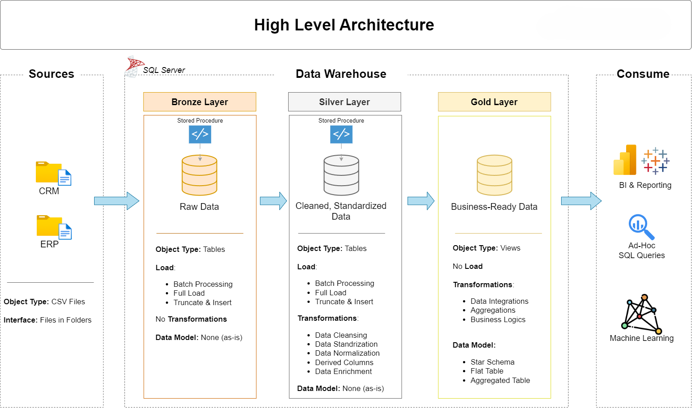

# End-to-End SQL Data Warehouse & Analytics Project

This project is an end-to-end modern data warehousing solution built from scratch in **PostgreSQL** following the **Medallion Architecture** (**Bronze**, **Silver**, and **Gold** layers). 

The pipeline ingests raw CRM and ERP CSV datasets, performs rigorous data cleansing and standardization, and models the curated data into an analytical **Star Schema** ready for Business Intelligence (BI) reporting.

---

## 🏗️ Data Architecture

The data warehouse is structured around the three-tier **Medallion Architecture**:



1. **Bronze Layer (Raw Ingestion):** Stores raw, unaltered data loaded directly from source CRM and ERP CSV files into PostgreSQL tables using bulk `COPY` operations.
2. **Silver Layer (Cleansing & Standardization):** Cleans, deduplicates, standardizes categorical values (e.g., gender, marital status, country codes), fixes invalid dates and pricing anomalies, and enforces proper data types.
3. **Gold Layer (Analytical Star Schema):** Exposes business-ready views modeled into fact and dimension tables (`gold.fact_sales`, `gold.dim_customers`, `gold.dim_products`) with surrogate keys for downstream BI and ad-hoc SQL analytics.

---

## ⭐ Gold Layer Data Model (Star Schema)

The Gold layer is designed for fast, intuitive analytical querying:

* **`gold.fact_sales` (Fact Table):** Transactional line-item sales records containing foreign keys (`customer_key`, `product_key`), order/shipping/due dates, `sales_amount`, `quantity`, and `price`.
* **`gold.dim_customers` (Dimension Table):** Enriched customer profiles integrating CRM demographics with ERP birthdate and geographic location data.
* **`gold.dim_products` (Dimension Table):** Current product catalog combining CRM product metadata with ERP category, subcategory, and maintenance attributes (filtering out historical records).

> 📖 For full column-level definitions, data types, and grain specifications, refer to the **[Gold Layer Data Catalog](docs/data_catalog.md)**.

---

## 📂 Repository Structure


### Execution Steps
1. **Clone the Repository:**
   ```bash
   git clone https://github.com/<your-username>/<your-repo-name>.git
   cd <your-repo-name>
   ```
2. **Initialize Database & Schemas:**
   Run `scripts/init_database.sql` in pgAdmin to create the `DataWarehouse` database along with the `bronze`, `silver`, and `gold` schemas.
3. **Build & Load the Bronze Layer:**
   * Execute `scripts/bronze/ddl_bronze.sql` to create raw tables.
   * Update the file paths inside `scripts/bronze/proc_load_bronze.sql` to match your local `datasets/` directory and execute the script.
4. **Build, Load & Validate the Silver Layer:**
   * Execute `scripts/silver/ddl_silver.sql` followed by `scripts/silver/proc_load_silver.sql`.
   * Run `tests/quality_checks_silver_layer.sql` to verify zero duplicates, trimmed strings, and valid date/sales ranges.
5. **Create & Validate the Gold Layer:**
   * Execute `scripts/gold/ddl_gold.sql` to generate `dim_customers`, `dim_products`, and `fact_sales` views.
   * Run `tests/quality_checks_gold_layer.sql` to confirm surrogate key uniqueness and 100% referential integrity across the Star Schema.


